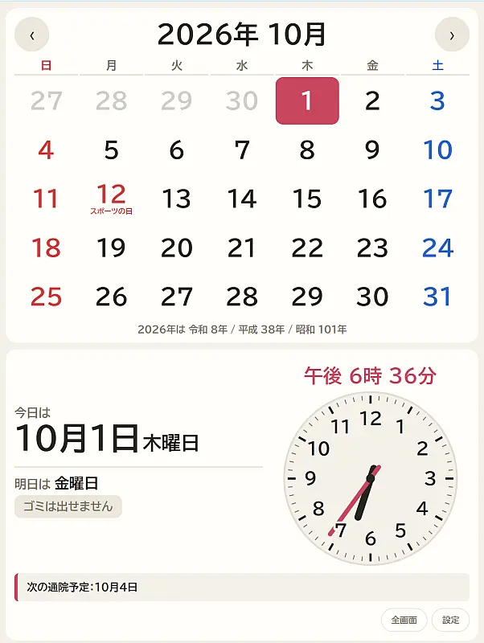
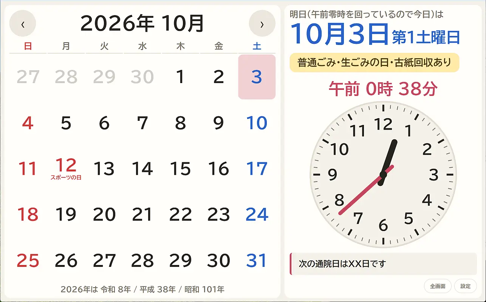
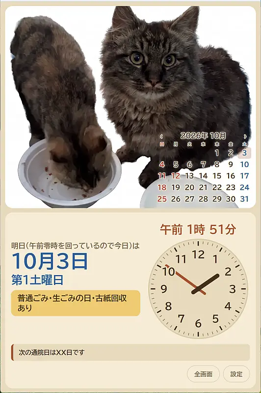
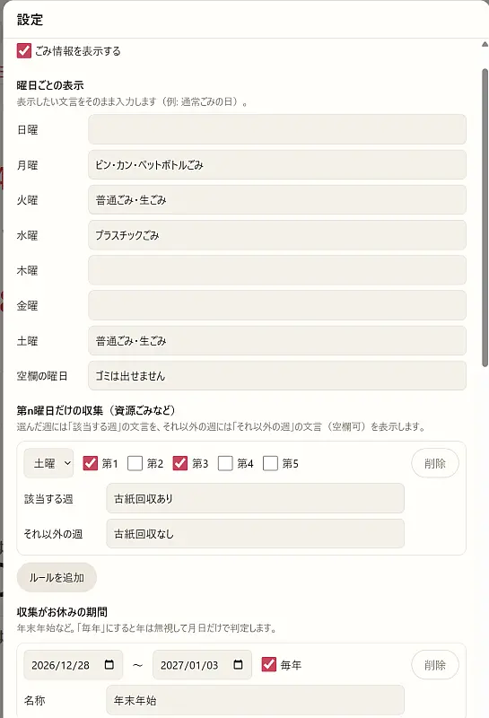
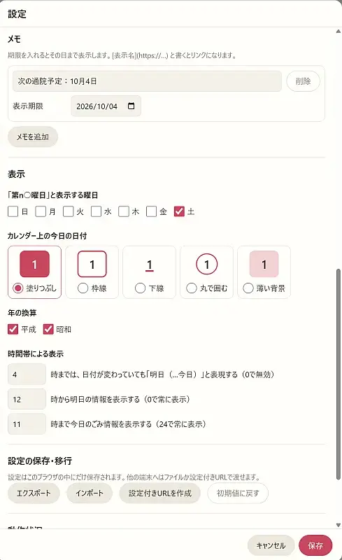

# GarbageCal2

曜日がわからなくなりがちな高齢者向けの、ごみ収集日＆メモ表示機能付きカレンダーアプリです。

電源を繋いだ8～10インチ程度のAndroidタブレットを、ディスプレイの自動消灯機能をオフにしてブラウザを常時表示させておく想定です。

|カレンダー表示(縦)|(横)|写真入り|
|---|---|---|
||||

|設定画面1|設定画面2|
|---|---|
|||


## 設置

中身を **HTTPS** で配信できる場所にそのまま置きます（オフライン動作に使う Service Worker が HTTPS 必須のため）。

手元で試すとき:

```
python -m http.server 8765
```

→ http://127.0.0.1:8765/

Github Page（このサイト）に設置したものをそのまま使うとき：

https://id-fa.github.io/GarbageCal2/

## 設定

画面右下の「設定」から編集します。設定はそのブラウザの localStorage にだけ保存されます。

- **ごみ収集** … 曜日ごとの文言、第n曜日だけの収集（資源ごみなど）、収集がお休みの期間（年末年始など）を設定します。
- **曜日ごとの表示（セカンダリ）** … ごみ情報とは別の行に、曜日ごとの文言（デイサービスの日など）を表示します。空欄の曜日は何も表示しません。
  大きい文字での表示と、表示しない期間（長期の休みなど）を設定できます。
- **エクスポート / インポート** … JSON ファイルで保存・読み込み
- **設定付きURL** … 設定を埋め込んだ URL を作成。タブレットのブラウザのホームに設定すれば、その設定で表示されます。
  開いたときに取り込むかどうかの確認が出ます。同じ URL の設定が適用されるのは最初の1回だけなので、タブレット側で後から設定を変えても、開き直したときに巻き戻りません。
  URL に載せられる設定の大きさには上限があります（メモが多いと超えます）。超える場合はエクスポート / インポートを使ってください。
- **写真** … 端末内の写真を選ぶと、カレンダーを小さくして下の隅（左下か右下）に寄せ、空いたところに写真を表示します。
  写真は縮小したうえでそのブラウザの中（IndexedDB）に保存されます。エクスポートや設定付きURLには含まれないので、端末ごとに選んでください。
- **ノート** … ノートの見た目（切り替える範囲、罫線、用紙の配色、書体、文字の大きさ）を選びます。本文は設定には含まれません（下記）。

## ノート

画面右下の「ノート」で、カレンダーと Markdown で書けるメモ帳を切り替えます。置き換える範囲は設定で「画面全体」「カレンダーの部分だけ」「時計の部分だけ」から選べます。
ノートを開いたまま1時間ほど触らずにいると（編集中でなければ）カレンダーに戻ります。

- **ページ** … 上部のタブで切り替えます。「編集」中は「＋ ページ」で追加、「ページ名」で名前を変更、タブを指で引きずって並べ替えができます。
- **編集** … 「見たまま」（書式ボタンで太字・見出し・箇条書き・チェック・リンクなど）と「ソース」（Markdown をそのまま書く）を切り替えられます。「完了」で閲覧に戻ります。入力は自動で保存されます。編集中は、切り替える範囲の設定にかかわらず画面全体を使います。
- **チェック項目** … `- [ ] 牛乳` のように書くとチェックボックスになり、閲覧中でもタップでオン／オフできます（買い物リストなど）。
- **手書き** … 「編集」中の「手書き」で画面いっぱいの手書きパッドが開き、指やペンで大きく書けます（ペンは黒・赤・青、太さは固定）。「決定」で本文に縮小して入り、閲覧中にタップすると元の大きさで表示されます。画像は1ページに1つで、もう一度「手書き」か画像をタップすると描き足し・描き直し・削除ができます。
  画像は描いたときの大きさのまま、`` の行として本文に埋め込まれます（Markdown のエクスポートにもそのまま入ります）。そのぶんページが大きくなるので、保存領域に収まらなくなったら古い手書きを消してください。
- **文字の大きさ** … ノート画面の「文字」ボタンで 小・中・大・特大 を順に切り替えます。
- **保存・移行** … ノートの本文は設定とは別に、そのブラウザの localStorage に保存されます。「編集」中のボタンで、ノート全体を JSON ファイルにエクスポート／インポートできるほか、1ページを Markdown ファイル（.md）として保存したり、Markdown ファイルをページとして追加したりできます。

対応している書き方は、`# 見出し`（#〜####）、`- 箇条書き`、`1. 番号付き`、`- [ ] チェック`、`> 引用`、`---` 区切り線、` ``` ` コード、`**太字**`、`*斜体*`、`~~取り消し~~`、`` `コード` ``、`[表示名](https://…)`、素の URL、手書き画像の ``（1行まるごと。`data:` に埋め込んだ PNG / WebP / JPEG だけで、外部の画像 URL は読み込みません）です。
改行はそのまま改行に、空行は空の行になります（一般的な Markdown のように段落にまとめることはしません）。入れ子の箇条書きは行頭を2文字以上下げます。記号を文字として書きたいときは `\` を前に付けます。


## 仕組み

- **時刻** … 端末の時計は信用せず、サーバーの `Date` ヘッダーとの差で補正します（起動時・復帰時・1時間ごと）。日付の計算は端末のタイムゾーン設定によらず日本時間固定です。
- **祝日** … [Holidays JP API](https://holidays-jp.github.io/) から週1回取得して localStorage に保存します。取得できない間は同梱の `syukujitsu.csv`（〜2027年）、それ以降の年は祝日法に基づく計算で表示します。
  `syukujitsu.csv` は[内閣府の CSV](https://www8.cao.go.jp/chosei/shukujitsu/gaiyou.html) と同じ形式で、公式ファイル（Shift_JIS）にそのまま置き換えられます。
- **オフライン** … 一度開けば Service Worker がファイル一式をキャッシュし、オフラインでも起動します。オンラインのときは常にサーバーの最新ファイルを使います。

## ファイルを追加・削除したとき

`sw.js` の `ASSETS`（オフライン用にキャッシュするファイル一覧）を合わせて更新し、`CACHE` の番号を上げてください。

